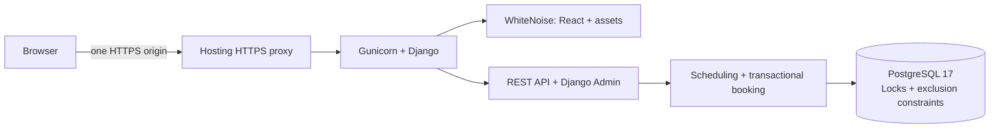
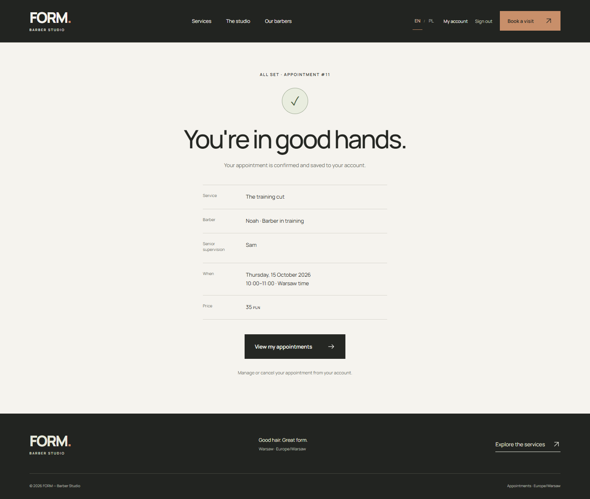

# Barber Booking Platform

This is a personal full-stack portfolio project. React, Django REST Framework and PostgreSQL power an appointment booking application. FORM Barber Studio is a fictional demonstration brand, not a paying client.

## Overview

Customers choose a service, barber and available time, register/sign in, save an appointment and cancel future visits. Availability accounts for service duration, shifts, breaks, days off and existing bookings. Training visits reserve a trainee and Senior supervisor together.

## Key Features

- Registration, login/logout and account history with session authentication and CSRF.
- Five-step booking, real API availability, confirmation and future cancellation.
- Junior/Senior/Top Barber pricing and historical price/duration snapshots.
- Training haircuts at 50% of the reference Junior price, with Senior supervision.
- PostgreSQL exclusion constraints, occupancy triggers, transactions and ordered staff locks.
- Django Admin for catalog, schedules, breaks, days off and appointments.
- EN/PL localization, persistent language choice and responsive layouts.
- Same-origin frontend/API, database health check and bilingual public-demo contact notice.

## Tech Stack

| Layer | Tools |
| --- | --- |
| Frontend | React, TypeScript, Vite, locally hosted Manrope |
| Backend | Python 3.13, Django 5.2, Django REST Framework, psycopg |
| Database | PostgreSQL 17, btree_gist |
| Serving | Gunicorn, WhiteNoise, multi-stage Docker image |
| Deployment configuration | Complete Docker Compose; Render web service + hosted PostgreSQL |
| Verification | Django tests, Node test runner, TypeScript, Prettier, HTTP smoke checks |
| CI | GitHub Actions: backend, frontend and Docker integration jobs |

Python dependencies are pinned in `backend/requirements.txt`; npm dependencies are locked in `frontend/package-lock.json`. Node >=22.12 is supported; CI tests exactly 22.12.0 with explicit TypeScript stripping. Regenerate Python pins with `pip-compile --output-file backend/requirements.txt backend/requirements.in` using Python 3.13 and pip-tools.

## Architecture



Production serves React at `/`, API at `/api/`, and Admin at `/admin/`. Hash routing and relative API requests remain intact. Development uses Vite's API proxy. No browser CORS setup is needed.

`frontend/src/Booking.tsx` contains state/API orchestration (282 lines); seven typed components implement its steps and summary. `backend/studio/` contains scheduling, booking, API, Admin and tests. Historical migrations remain unchanged. [API.md](docs/API.md) lists endpoints.

## Interesting Engineering Challenges

1. **Overlap:** GiST exclusion constraints use half-open `[start, end)` intervals, allowing adjacent appointments.
2. **Concurrency:** transactions lock participating staff in ID order and recheck availability. Triggers also protect direct writes. Conflicts return HTTP 409.
3. **Supervision:** training intersects both people's schedules, breaks, days off and bookings. Database-maintained occupancy rows reserve/release both together.
4. **Timezone/DST:** timezone-aware timestamps and Warsaw display; invalid/ambiguous wall times and shifts crossing an offset change are not offered.
5. **Historical pricing:** saved service name, duration, price and barber level survive later catalog updates.

## Running Locally — Developer Mode

Requirements: Python 3.13, Node >=22.12, npm, PostgreSQL 17. The DB role must create `btree_gist`; tests require `CREATEDB`. Windows commands:

```powershell
py -3.13 -m venv backend/.venv
backend/.venv/Scripts/python.exe -m pip install -r backend/requirements.txt
backend/.venv/Scripts/python.exe scripts/create_local_env.py
# If using Docker for the database:
docker compose --env-file backend/.env up -d --wait db
backend/.venv/Scripts/python.exe backend/manage.py migrate
backend/.venv/Scripts/python.exe backend/manage.py seed_demo
backend/.venv/Scripts/python.exe backend/manage.py runserver 127.0.0.1:8000
```

An existing PostgreSQL server is also supported with matching `POSTGRES_*` values. This review used the prepared portable database on 5433. The environment helper preserves an existing `.env`. In a second terminal:

```powershell
cd frontend
npm.cmd ci
npm.cmd run dev
```

Open **http://127.0.0.1:5173**; Admin is **http://127.0.0.1:8000/admin/**. Use one hostname consistently for cookies. On macOS/Linux use `python3.13`, `backend/.venv/bin/python` and `npm`; that platform-specific developer setup was not executed here. Portable tools/environments are excluded from source.

## Running Locally — Complete Docker Application

```text
python scripts/create_local_env.py
docker compose --env-file backend/.env up --build -d --wait
docker compose --env-file backend/.env exec web python manage.py seed_demo
```

Open **http://127.0.0.1:8080** and `/admin/`. Compose starts both services, waits for database health and applies migrations. Its PostgreSQL volume persists between starts. Local Docker uses DEBUG=False with HTTP settings; Render uses HTTPS. Seed intentionally; no reset runs on every restart. Reseeding updates fictional catalog values and standard hours while preserving accounts, appointments and days off.

Choose another `POSTGRES_PORT` if the host port is occupied. Changing `.env` passwords does not update an existing PostgreSQL role. **Compose configuration was validated; Docker Engine is absent here, so image build/start remain unverified locally.** CI includes those checks.

## Environment Variables

See [backend/.env.example](backend/.env.example) and [deployment reference](docs/DEPLOYMENT.md#environment). A nonempty PostgreSQL `DATABASE_URL` overrides local `POSTGRES_*`; SQLite is rejected. Hosted connections use SSL by default with DEBUG=False.

DEBUG defaults to False. Public HTTPS enables secure cookies, redirects and HSTS. Render's exact hostname is added to allowed hosts/CSRF origins; custom domains require explicit entries. Trust proxy headers only behind the configured hosting proxy. Never put secrets in React or `VITE_*` variables.

## Running Tests

With PostgreSQL running:

```powershell
backend/.venv/Scripts/python.exe -m pip check
backend/.venv/Scripts/python.exe backend/manage.py check
backend/.venv/Scripts/python.exe backend/manage.py makemigrations --check --dry-run
backend/.venv/Scripts/python.exe backend/manage.py migrate --check
backend/.venv/Scripts/python.exe backend/manage.py test studio.tests --noinput
```

From `frontend/`:

```powershell
npm.cmd ci
npm.cmd test
npm.cmd run typecheck
npm.cmd run build
npm.cmd run format:check
```

**44 backend tests and 7 frontend tests passed** locally, along with types, build, formatting and Django checks. Tests cover ownership, CSRF, validation, prices, DST, supervision, concurrent API/ORM writes, secure settings, health failures and frontend routing. Django creates a separate PostgreSQL test database. With production manifest storage, run `collectstatic --noinput` before Admin-related tests; CI does this too.

Use `python scripts/smoke_http.py <ORIGIN>` to check the actual same-origin application. `--exercise-bookings` creates a fictional account and two cancelled visits; see [documented data impact](docs/DEPLOYMENT.md#acceptance-checks). Local Edge review exercises the real UI; no Playwright E2E dependency or browser CI suite is included.

## CI

The workflow runs on push to `main` and pull requests: Python 3.13/PostgreSQL 17 tests, Node 22.12.0 tests/types/build/formatting, production settings, and complete Docker HTTP checks including both booking types and cancellation. Credentials are disposable test values. **A green GitHub run is pending publication.**

## Deployment

[DEPLOYMENT.md](docs/DEPLOYMENT.md) covers Render, hosted PostgreSQL, migrations, initial seed, health, acceptance checks and safe redeploys. The Blueprint specifies paid resources; review charges before applying. No external resources or URL were created here.

## Screenshots

Actual local React production build served by Django + WhiteNoise, backed by PostgreSQL, captured in Edge on October 14, 2026. All customer details are fictional. These are local captures, not evidence of a public deployment.


[Services/pricing](docs/screenshots/02-services-pricing.png) · [Barber selection](docs/screenshots/03-barber-selection.png) · [Date/time](docs/screenshots/04-date-time-booking.png) · [Confirmation](docs/screenshots/05-booking-confirmation.png) · [Account](docs/screenshots/06-account-upcoming.png) · [Polish mobile](docs/screenshots/07-mobile-booking-pl.png)



See [SCREENSHOTS.md](docs/SCREENSHOTS.md) for capture context and reuse guidance.

## Project Status

This is a personal portfolio demonstration and is not currently deployed publicly. It is not a production service for a real barber business. Add Live Demo/GitHub links only after real destinations exist and are checked.

Booking supports 60 days ahead, 30 minutes' notice, and starts every 15 minutes from shift opening. One daytime shift per weekday; overnight/DST-crossing shifts are unsupported. Schedule changes do not move bookings; homepage hours are editorial. Throttling is per-process, so the demo uses one Gunicorn process. Payments, Redis, Celery, SMS and extra product features are outside this final scope.

## Portfolio and Source Package

[PORTFOLIO.md](docs/PORTFOLIO.md) contains Upwork copy. [FINAL_DEMO_REVIEW.md](docs/FINAL_DEMO_REVIEW.md) records results/actions; [ASSETS.md](docs/ASSETS.md) records asset provenance.

```powershell
backend/.venv/Scripts/python.exe scripts/package_source.py
backend/.venv/Scripts/python.exe scripts/verify_source.py
```

The ZIP includes Docker, Render, CI and real screenshots; excludes secrets, tools, dependencies, database data, caches and build output. Publish reviewed source only. The final review supersedes historical repository/deployment/screenshot status notes.
