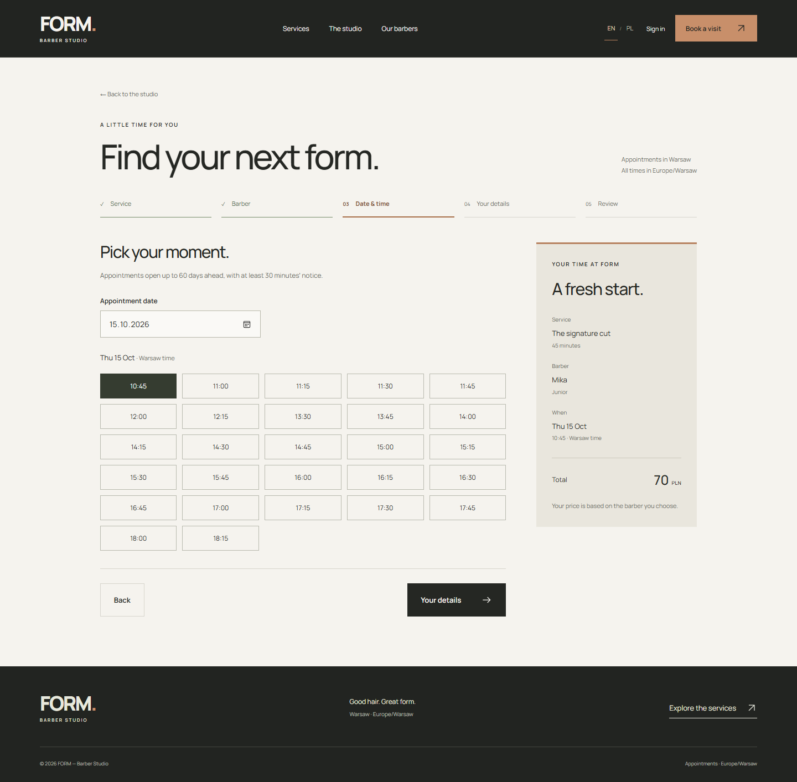

# Barber Booking Platform

Personal portfolio project: an appointment booking app for a fictional barber studio.

[Live demo](https://barber-booking-web.onrender.com/) · [GitHub](https://github.com/Daniil-std/barber-booking)

Customers can register, choose a service and barber, book an available slot, and cancel future visits. The responsive interface supports English and Polish. Django Admin manages services, staff and schedules.

Availability accounts for shifts, breaks and days off. PostgreSQL constraints and locks prevent overlapping bookings, including training visits that reserve a trainee and Senior supervisor together. Prices and durations are saved with each appointment.

## Stack

Python 3.13, Django REST Framework, PostgreSQL 17, React, TypeScript and Vite (Node >=22.12). Docker Compose runs the app locally; Gunicorn and WhiteNoise serve the production build. Tests run in GitHub Actions.

## Screenshots





[All eight screenshots](docs/SCREENSHOTS.md) are from the local app, using fictional contact details.

Studio photo: [Redd Francisco](https://unsplash.com/photos/a-barber-shop-with-a-chair-and-a-mirror-BBGyxhtPpC0), [Unsplash License](https://unsplash.com/license). Font: [Manrope](https://fontsource.org/fonts/manrope), SIL Open Font License 1.1.

## Local setup

Requires Docker Compose and Python 3 for the environment helper.

```sh
python scripts/create_local_env.py
docker compose --env-file backend/.env up --build -d --wait
docker compose --env-file backend/.env exec web python manage.py seed_demo
```

Open **http://127.0.0.1:8080**. Admin is at `/admin/`.

The helper preserves an existing `.env`. The seed adds fictional services, staff and schedules. Data stays in a Docker volume. Keep `.env` private and use fictional contact details in the demo.

See [deployment notes](docs/DEPLOYMENT.md) and the [API reference](docs/API.md).

## Tests

With Compose running:

```sh
docker compose --env-file backend/.env exec web python manage.py test studio.tests --noinput
```

From `frontend/`:

```sh
npm ci
npm test
npm run typecheck
npm run build
npm run format:check
```
