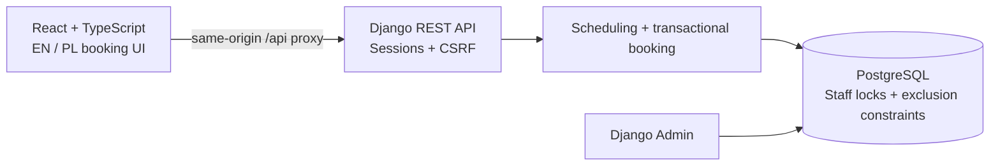

# Barber Booking Platform

A personal full-stack portfolio project. A Django REST API and React interface for booking barber appointments and coordinating staff availability. FORM Barber Studio is a fictional demonstration brand, not a paying client.

## Overview

Booking must account for service duration, working hours, breaks, days off, and existing reservations. Customers choose a service, barber, and available time, then save or cancel appointments through their account. Training appointments reserve a trainee and Senior supervisor for the entire visit.

## Key Features

- Customer registration, login, logout, and account history with session authentication and CSRF protection.
- Service/barber selection, availability calculation, booking confirmation, and cancellation of future appointments.
- Staff schedules, recurring breaks, days off, catalog management, and cancellation through Django Admin.
- Junior, Senior, and Top Barber pricing, server-provided quotes, and appointment price/duration snapshots.
- Training haircuts at 50% of the reference service's Junior price with an assigned Senior supervisor.
- Transactions, ordered staff locks, PostgreSQL occupancy triggers, and GiST exclusion constraints to prevent overlapping bookings.
- EN/PL localization, persistent language selection, responsive layouts, keyboard focus, and reduced-motion styles.

## Tech Stack

| Layer | Tools |
| --- | --- |
| Frontend | React, TypeScript, Vite, locally hosted Manrope font |
| Backend | Python 3.13, Django 5.2, Django REST Framework, psycopg |
| Database | PostgreSQL 17, btree_gist extension |
| Testing | Django APITestCase/TransactionTestCase/SimpleTestCase, Node.js test runner |
| Quality | TypeScript strict checks, Prettier |
| Local database | Docker Compose or an existing PostgreSQL server |

Exact Python versions are pinned in `backend/requirements.txt`; npm dependencies are locked in `frontend/package-lock.json`. Node **22.12 or newer** is supported. The test script explicitly enables TypeScript stripping for the minimum version; see [Node's 22.12 documentation](https://nodejs.org/download/release/v22.12.0/docs/api/cli.html#--experimental-strip-types).

## Architecture



```text
frontend/src/Booking.tsx              Booking state, API requests and orchestration
frontend/src/components/booking/     Five steps, summary and confirmation
frontend/src/translations/           Polish dictionary; English source strings
backend/studio/                      Models, scheduling, services, API and Admin
backend/studio/migrations/           Database constraints and occupancy triggers
backend/studio/tests/                API, database, concurrency and settings tests
scripts/                            Environment, startup and source packaging
compose.yaml                        PostgreSQL only; Django/Vite run locally
```

The browser receives real catalog data and availability, with no simulated booking fallback. See [docs/API.md](docs/API.md) for endpoints and [docs/ASSETS.md](docs/ASSETS.md) for asset provenance.

## Interesting Engineering Challenges

1. **Double bookings and overlapping ranges:** database exclusion constraints reject overlapping confirmed appointments. Half-open intervals `[start, end)` allow adjacent appointments.
2. **Concurrent requests:** booking locks participating staff in ID order inside a transaction, rechecks availability, and inserts the appointment. A before-write trigger applies ordered locking to direct database writes. Conflicts return HTTP 409 and the UI refreshes available slots.
3. **Trainee and supervisor availability:** available starts intersect both staff schedules, breaks, days off, and reservations. A trigger maintains one occupancy row for a regular visit and two for training; cancellation releases both.
4. **Timezone/DST handling:** timestamps are timezone-aware; schedules and display use Europe/Warsaw. Ambiguous/nonexistent wall times and shifts crossing an offset change are not offered.
5. **Historical prices:** the backend computes and snapshots price, service name, duration, and barber level at creation. Catalog changes do not rewrite saved appointment prices.

## Running Locally

Requirements: Python 3.13, Node >=22.12 with npm, and PostgreSQL 17. The database user needs permission to create `btree_gist`; backend tests also require `CREATEDB`.

From a fresh source directory on Windows:

```powershell
py -3.13 -m venv backend/.venv
backend/.venv/Scripts/python.exe -m pip install -r backend/requirements.txt
backend/.venv/Scripts/python.exe scripts/create_local_env.py
```

The helper creates unique secrets without printing them and leaves an existing `backend/.env` unchanged. Alternatively, copy `backend/.env.example` to `backend/.env`, generate a secret key as described there, and replace the password placeholder.

For a Docker database:

```powershell
docker compose --env-file backend/.env up -d --wait db
```

Compose interpolation requires `--env-file backend/.env`. PostgreSQL is published on loopback only, with data retained in a named volume. Django runs on the host, so `POSTGRES_HOST=127.0.0.1` is intentional. Changing the environment password does not change an already initialized database role; update that role as well.

For an existing PostgreSQL server, create a database/role and set matching connection values in `backend/.env`. This workspace's `scripts/start-local.ps1` supports prepared portable PostgreSQL on port 5433; it is not needed for a fresh clone.

Then run:

```powershell
backend/.venv/Scripts/python.exe backend/manage.py migrate
backend/.venv/Scripts/python.exe backend/manage.py seed_demo
backend/.venv/Scripts/python.exe backend/manage.py createsuperuser
backend/.venv/Scripts/python.exe backend/manage.py runserver 127.0.0.1:8000
```

In a second terminal:

```powershell
cd frontend
npm.cmd ci
npm.cmd run dev
```

Open **http://127.0.0.1:5173**. Admin is at **http://127.0.0.1:8000/admin/**. Use the same hostname consistently for cookies and CSRF. Vite proxies `/api/` to Django; no CORS package is required.

On macOS/Linux, use `python3.13 -m venv backend/.venv`, `backend/.venv/bin/python`, and `npm` in place of Windows paths. That platform-specific setup was not executed here. Existing PostgreSQL startup was verified; Compose configuration validation passed using its standalone binary. Docker Engine is not installed on the review machine, so container startup needs verification on a Docker-enabled machine. Exact results are in [docs/PUBLICATION_REVIEW.md](docs/PUBLICATION_REVIEW.md).

`seed_demo` creates fictional catalog/staff data and standard Monday–Saturday hours. It creates no customer accounts or passwords. Repeating it updates catalog values and standard hours while retaining existing reservations, accounts, and days off. Review those updates before reseeding a customized catalog.

## Environment Variables

[backend/.env.example](backend/.env.example) lists every environment setting read by Django:

| Variable | Purpose |
| --- | --- |
| DJANGO_SECRET_KEY | Unique random key, at least 32 characters |
| DJANGO_DEBUG | True for local HTTP; False enables secure cookies and HTTPS redirects |
| DJANGO_ALLOWED_HOSTS | Comma-separated accepted hostnames |
| DJANGO_CSRF_TRUSTED_ORIGINS | Comma-separated exact browser origins |
| POSTGRES_DB / POSTGRES_USER / POSTGRES_PASSWORD | Database connection credentials |
| POSTGRES_HOST / POSTGRES_PORT | Host-side PostgreSQL endpoint |

Django loads `backend/.env` without overriding process variables. DEBUG defaults to False; malformed boolean values fail at startup. Host/origin lists trim whitespace. [frontend/.env.example](frontend/.env.example) contains optional server-side `API_PROXY_TARGET`. Credentials never belong in frontend variables or `VITE_*` values.

For `npm.cmd run preview` (port 4173), add `http://127.0.0.1:4173` to trusted CSRF origins and restart Django before testing account actions.

## Running Tests

With PostgreSQL running, from the root:

```powershell
backend/.venv/Scripts/python.exe backend/manage.py check
backend/.venv/Scripts/python.exe backend/manage.py makemigrations --check --dry-run
backend/.venv/Scripts/python.exe backend/manage.py migrate --check
backend/.venv/Scripts/python.exe backend/manage.py test studio.tests --noinput
```

Tests create and destroy a separate test database. They cover booking/cancellation, ownership, CSRF, validation, interval boundaries, pricing snapshots, DST, supervision, concurrent API/direct ORM writes, and secure settings defaults.

From `frontend/`:

```powershell
npm.cmd ci
npm.cmd test
npm.cmd run typecheck
npm.cmd run build
npm.cmd run format:check
```

Seven Node tests check translations (including nested components), interpolation, supported errors, seeded catalog translations, and server-provided prices. No frontend lint script or automated browser regression suite is configured.

## Screenshots

Real screenshots have not yet been added. Follow [docs/SCREENSHOTS.md](docs/SCREENSHOTS.md) using fictional test details and add image links after capture. The licensed studio photograph is a design asset, not an application screenshot.

## Project Status

This application is a personal portfolio project and is not currently deployed as a production service.

Booking supports 60 days ahead, 30 minutes' notice, and starts every 15 minutes relative to shift opening. There is one daytime shift per barber per weekday; overnight/DST-crossing shifts are unsupported. Schedule changes do not move existing reservations. Homepage opening hours are editorial content that must be updated alongside schedule changes.

Payments, SMS/email reminders, email verification, password reset, and a waitlist are possible future additions. Production would also need a WSGI server, HTTPS reverse proxy, static serving, backups, monitoring, and a shared throttle cache. Current servers are development tools.

## Portfolio and Publication

[docs/PORTFOLIO.md](docs/PORTFOLIO.md) provides an honest Upwork description. [docs/PUBLICATION_REVIEW.md](docs/PUBLICATION_REVIEW.md) records checks and remaining publication actions.

Create a source-only package with:

```powershell
backend/.venv/Scripts/python.exe scripts/package_source.py
```

This creates the ignored `barber-booking-source.zip`, excluding secrets, dependencies, tools, databases, caches, and build output. Keep `barber-booking-under-512mb.zip` private: it contains local credentials and database data. Publish the source-only package or reviewed Git-tracked source, never the entire workspace.
