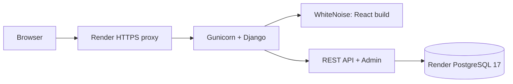

# Deployment

This is a personal full-stack portfolio project. FORM Barber Studio is fictional. The repository prepares a public demonstration; no external service has been deployed by this review.

## Architecture

One public HTTPS origin serves React, `/api/`, and `/admin/`. Render's HTTPS proxy forwards requests to Gunicorn, Django and WhiteNoise. PostgreSQL 17 stores accounts, appointments and both staff reservations for supervised training. There is no browser CORS configuration.



## Prerequisites and verification boundary

You need your GitHub repository, a Render account, and approval of Render's displayed charges. `render.yaml` selects a paid web plan and a paid 1 GB PostgreSQL database in Frankfurt. This supports a pre-deploy migration step and avoids the free database's 30-day expiry. No paid resources have been created. Review current prices in the dashboard before applying the Blueprint.

Local PostgreSQL tests and serving the real frontend build are checked in [FINAL_DEMO_REVIEW.md](FINAL_DEMO_REVIEW.md). Docker Engine is unavailable on the review machine. Container build/start and the Render process below remain to be executed on Docker/Render; they are deployment instructions, not claims of completed deployment.

Provider references checked for this configuration: [Blueprint fields](https://render.com/docs/blueprint-spec), [pre-deploy commands](https://render.com/docs/deploys), [free limits](https://render.com/docs/free).

## GitHub and CI

Create the intended repository yourself, review the complete diff, and commit the source. Do not upload the whole workspace. After the commit:

```text
git remote add origin <GITHUB_REPOSITORY_URL>
git push -u origin main
```

If a remote already exists, inspect it instead of adding another. The CI workflow checks backend, frontend, and a built Docker Compose application on Ubuntu. Wait for all three jobs to finish green before deploying. No GitHub workflow run has occurred locally.

## Render Blueprint

1. In Render choose **New → Blueprint**, connect that GitHub repository, and select `main` and the root `render.yaml`.
2. Review the resource names, Frankfurt region, web/database plans, storage and billing. Avoid names that would accidentally match your existing services.
3. Approve creation only after reviewing costs. Render creates PostgreSQL 17 and supplies its private connection string to `DATABASE_URL`. Public database access is disabled with `ipAllowList: []`.
4. The Docker build installs pinned Python dependencies, builds React with `npm ci`, and collects Admin static files without connecting to a database. The final container runs as UID 10001.
5. `preDeployCommand` runs `python manage.py migrate --noinput` before each deploy. Historical migrations create `btree_gist`, constraints and occupancy triggers unchanged. A failing migration must block rollout.
6. `initialDeployHook` runs `python manage.py seed_demo` once after the first successful service deploy. Check its logs. A healthy service can briefly precede its catalog seed.
7. Copy the actual assigned HTTPS URL from Render. Only then add a Live Demo link to README and the portfolio. Do not invent one.

The Blueprint disables automatic deployment. After CI passes, choose **Manual Deploy → Deploy latest commit**. Source changes will not be silently deployed.

## Environment

| Variable | Deployment behavior |
| --- | --- |
| `DJANGO_SECRET_KEY` | Render-generated random secret; preserve across redeploys |
| `DJANGO_DEBUG` | `False` |
| `DJANGO_HTTPS` | `True`: secure cookies, HTTPS redirect and HSTS |
| `DJANGO_TRUST_PROXY` | `True` only behind the trusted Render HTTPS proxy |
| `DATABASE_URL` | Private Render PostgreSQL connection string; replaces local `POSTGRES_*` |
| `DATABASE_SSL_REQUIRE` | `True` for hosted PostgreSQL |
| `RENDER_EXTERNAL_HOSTNAME` | Render-provided hostname; settings add its exact host and HTTPS CSRF origin |
| `DJANGO_ALLOWED_HOSTS` | Additional exact hostnames; no wildcard |
| `DJANGO_CSRF_TRUSTED_ORIGINS` | Additional exact HTTP(S) origins; no wildcard or path |
| `PORT` | Gunicorn binds the hosting platform's port, default 8000 |

The local `backend/.env` is never part of the image. No secret is sent to React. For a custom domain, add its hostname and `https://` origin to the two Django lists and redeploy. Keep HTTPS enabled.

## Seed, Admin and redeployment

Commands below run in the paid Render web service's Shell, whose working directory is `/app/backend`:

```sh
python manage.py migrate --check
python manage.py seed_demo
python manage.py createsuperuser
```

The seed is idempotent and creates only fictional catalog, staff, schedules and breaks. It does not create customer accounts or passwords, delete appointments, or reset data on every restart. Rerunning it updates standard catalog values and working hours; review those changes before doing so on customized data. Creating a superuser is optional and interactive. Never publish its password.

Before redeploying, inspect changes, run CI, preserve secrets, and take a database backup if schema changes are involved. Do not run migrations during image build. Do not blindly roll back application code across incompatible schema changes. Review migration and seed logs after initial deployment.

## Acceptance checks

On your computer, using a working Python installation and the real public URL:

```text
python scripts/smoke_http.py <ACTUAL_HTTPS_ORIGIN>
python scripts/smoke_http.py <ACTUAL_HTTPS_ORIGIN> --exercise-bookings
```

The first command verifies DB health, React, assets, Admin CSS and seeded catalog. The optional second command creates a fictional `@example.test` account, registers/logs in, saves both regular and supervised appointments, lists and cancels them, and checks released availability. It retains that fictional account and cancelled records; it does not delete existing data. It exercises real HTTP, cookies and CSRF, not a mock API.

Also check in a real browser: homepage/photo/fonts, EN → PL switching, normal and training booking review, confirmation, account and cancellation, then a 390 px mobile view. Use fictional details. Inspect secure session/CSRF cookies, no mixed content, and no debug traceback on invalid routes. Capture real screenshots using [SCREENSHOTS.md](SCREENSHOTS.md).

`GET /api/health/` returns only `{"status":"ok"}` after `SELECT 1`, or generic 503 when the database is unavailable. This one route permits internal HTTP probes; other production routes redirect HTTP to HTTPS. Health exposes no versions, credentials or account information.

## Local complete Docker application

Generate ignored credentials, then start both services:

```text
python scripts/create_local_env.py
docker compose --env-file backend/.env config --quiet
docker compose --env-file backend/.env up --build -d --wait
docker compose --env-file backend/.env exec web python manage.py seed_demo
python scripts/smoke_http.py http://127.0.0.1:8080 --exercise-bookings
```

Open `http://127.0.0.1:8080` and `/admin/`. Compose explicitly uses DEBUG=False with local HTTP cookies, trusts no proxy, connects to `db:5432`, waits for database health, and runs migrations before Gunicorn. The container filesystem has no mounted workspace. The PostgreSQL volume persists between starts. `docker compose --env-file backend/.env down` stops services and retains the volume. Do not add `-v` unless you intend to delete this Compose database. CI uses `-v` only for its disposable database.

If your existing local database uses the published port (often 5433 in this prepared workspace), stop one database or choose another `POSTGRES_PORT` before starting Compose. This does not change the web container's internal DB port.

## Developer mode

The Vite + Django workflow in README remains supported. Run only the Compose `db` service if you need a Docker database for development. Vite proxies `/api/` to Django and serves its own frontend. Use matching `.env` credentials and the same browser hostname.

## Troubleshooting

- **400 / DisallowedHost:** confirm Render's actual hostname, or add the custom domain to exact allowed hosts. Do not use `*`.
- **403 / CSRF:** use one hostname, confirm the exact HTTPS origin, proxy setting and secure cookies; reload to obtain a new CSRF token. Do not disable CSRF.
- **Redirect loop:** verify Render's trusted `X-Forwarded-Proto` and `DJANGO_TRUST_PROXY=True`. Do not turn off public HTTPS.
- **503 health:** check database service, private connection string, SSL and migrations in private logs; keep credentials out of screenshots.
- **503 frontend / missing assets:** verify the frontend build and Docker copy stage; rebuild the image. Collect Admin static files after dependency changes.
- **Empty catalog:** check the initial seed hook; run the seed explicitly in Shell if it failed.
- **Password mismatch with local Compose:** a changed `.env` password does not update the role inside an existing volume. Update the role deliberately; do not delete the volume as a shortcut.
- **Slot returns 409:** availability changed; select another slot. Database guarantees remain active.
- **Slow or interrupted free demo:** this Blueprint uses paid plans. A free alternative would need another migration strategy and expires its database after 30 days; do not present it as a durable demo.

This remains a portfolio demonstration. There are no payments, reminders, email verification, password reset, or guarantees for a real business. Throttling uses a per-process cache; the image runs one Gunicorn process with four threads. Scaling needs separate review, outside this project's final scope.
